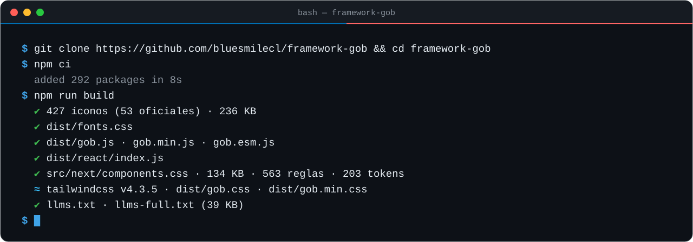
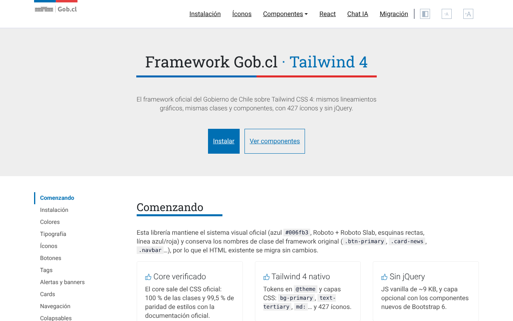
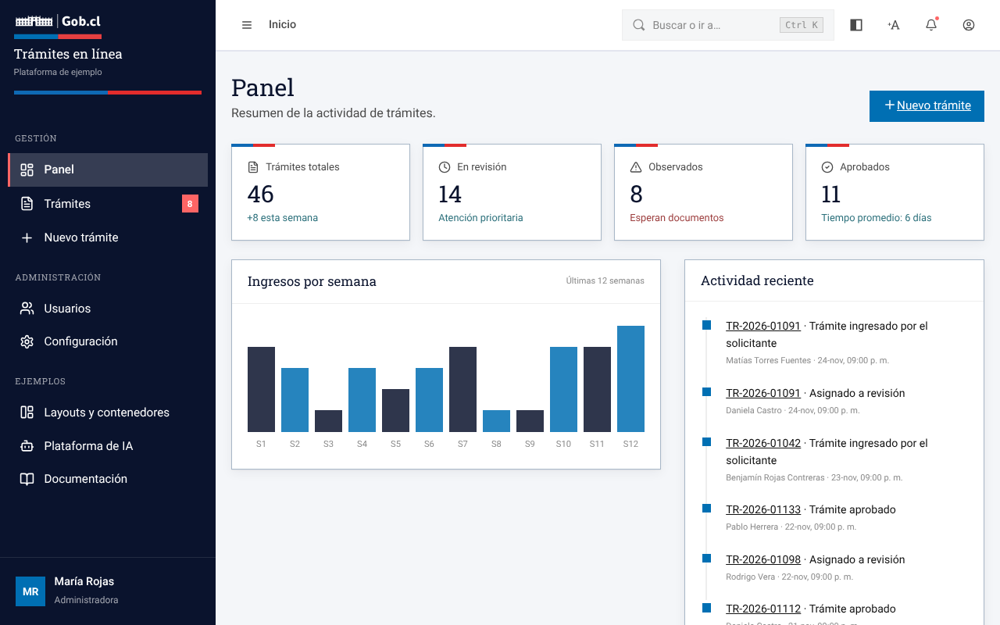
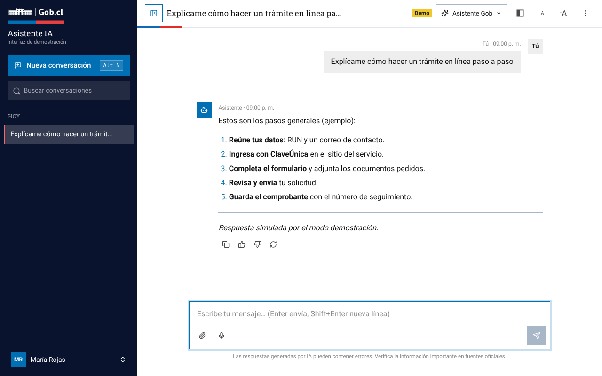
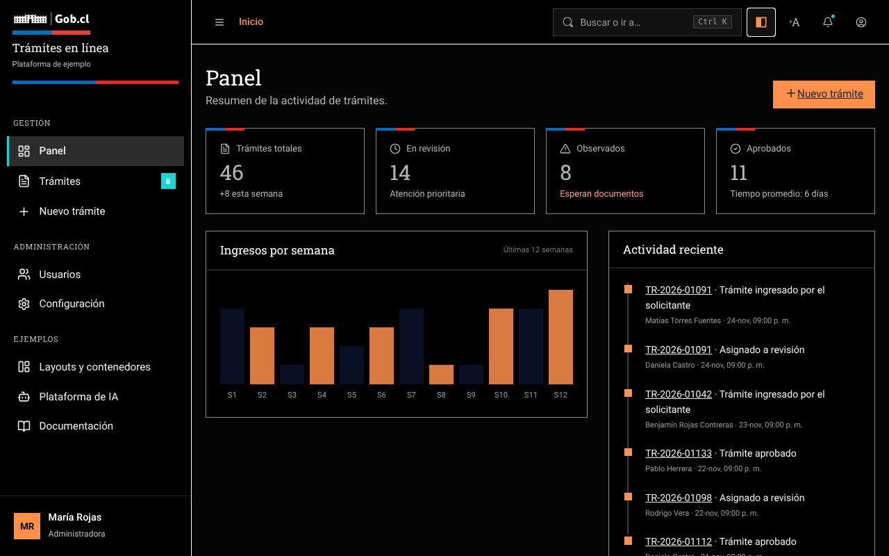

<div align="center">



<br>

[](https://framework-gob.vercel.app)
[](https://tailwindcss.com)
[](#-librería-de-componentes-react)
[](#-estado-verificado)
[](#-íconos)
[](LICENSE)
[](#-contribuir)

[Inicio rápido](#-inicio-rápido) · [Características](#-características) · [Demo en vivo](https://framework-gob.vercel.app) · [Componentes React](#-librería-de-componentes-react) · [Contribuir](#-contribuir)

</div>

---

**framework-gob** (paquete `gob-cl-tailwind`) es el **Framework CSS del Gobierno de Chile**
([framework.digital.gob.cl](https://framework.digital.gob.cl/)) reconstruido sobre **Tailwind CSS 4**. Es un traspaso
íntegro del framework oficial (`@gobdigital-cl/gob.cl` 3.0.10, que dependía de Bootstrap 4 + jQuery + Popper):
**mismo diseño y mismos nombres de clase**, ahora con tokens de Tailwind, capas CSS, JavaScript sin dependencias,
**427 íconos**, una **librería de componentes React** y una capa opcional con los componentes nuevos de **Bootstrap 6**.

> [!IMPORTANT]
> Proyecto comunitario **no oficial**. El diseño, la marca y los logotipos pertenecen al Gobierno de Chile /
> División de Gobierno Digital, y su uso debe respetar los lineamientos de la División.

<table>
<tr>
<td width="33%" valign="top">

### 🎯 Fiel al original
**100 %** de las 8.206 clases del CSS oficial y **99,52 %** de paridad de estilos medida contra la documentación
oficial. El HTML existente funciona sin cambios.

</td>
<td width="33%" valign="top">

### ⚡ Moderno y liviano
Tokens en `@theme`, capas CSS, utilidades de Tailwind que siempre ganan a los componentes y JavaScript vanilla de
~9 KB: **sin jQuery ni Popper**.

</td>
<td width="33%" valign="top">

### ♿ Accesible
Tema oficial de **alto contraste** (`html.a11y-contrast`, 99,47 % de paridad), modo de fuentes ampliadas, foco
visible y skip-link.

</td>
</tr>
</table>

## 🚀 Inicio rápido

> [!NOTE]
> `gob-cl-tailwind` todavía **no está publicado en npm**: se instala directo desde GitHub, con `dist/` ya compilado.
> Los imports usan el nombre del paquete, `gob-cl-tailwind`.

```bash
npm install github:bluesmilecl/framework-gob tailwindcss @tailwindcss/vite
```

```css
/* app.css: sin preflight, el reboot de Bootstrap ya viene en el core */
@import "tailwindcss/theme.css" layer(theme);
@import "gob-cl-tailwind/fonts.css";   /* Roboto + Roboto Slab */
@import "gob-cl-tailwind";             /* tokens + core Bootstrap 4/gob.cl + alto contraste + íconos */
@import "tailwindcss/utilities.css" layer(utilities);

/* Opcionales */
@import "gob-cl-tailwind/compat.css";  /* utilidades Bootstrap 4 (m-*, p-*, d-*, flex…) + modo a11y-fonts */
@import "gob-cl-tailwind/next.css";    /* componentes nuevos de Bootstrap 6 (alpha) con identidad gob.cl */
```

```js
import "gob-cl-tailwind/js";       // colapsables, dropdown, tabs, modal, toolbar (data-toggle)
import "gob-cl-tailwind/next/js";  // opcional: dialog, drawer, menu, combobox… (data-bs-toggle)
```

```html
<!-- Clases del framework oficial: sin cambios -->
<button class="btn btn-primary">Ingresar</button>
<button class="btn btn-outline-primary">Ver trámites</button>

<!-- Íconos como máscaras CSS: heredan currentColor -->
<i class="cl cl-search cl-2x"></i>

<!-- Las utilidades de Tailwind siempre ganan a los componentes -->
<button class="btn btn-primary p-2 md:px-8">Continuar</button>
```

### Sin build (reemplazo directo de `gob.cl.css`)

```html
<link rel="stylesheet" href="https://cdn.jsdelivr.net/gh/bluesmilecl/framework-gob@main/dist/fonts.css">
<link rel="stylesheet" href="https://cdn.jsdelivr.net/gh/bluesmilecl/framework-gob@main/dist/gob.min.css">
<script src="https://cdn.jsdelivr.net/gh/bluesmilecl/framework-gob@main/dist/gob.min.js" defer></script>
```

`dist/gob.min.css` incluye core, compat, alto contraste, a11y-fonts e íconos (146 KB comprimido). El HTML del
framework oficial funciona sin cambios.

> [!TIP]
> En producción cambia `@main` por el SHA de un commit para fijar la versión. Si instalaste con npm, usa las mismas
> rutas desde `node_modules/gob-cl-tailwind/dist/`.

<div align="center">

</div>

## 🔁 Cómo se construye

<div align="center">

</div>

El core **no se reescribió a mano**: `tools/build-core.mjs` parte el CSS oficial por módulo SCSS usando su sourcemap,
conserva el orden exacto de la cascada, convierte los colores literales en tokens (`var(--color-primary)`…) y el
icon-font en máscaras. Se regenera con `npm run build:core`.

Los componentes están en `@layer components`, por lo que una utilidad de Tailwind siempre los sobrescribe
(`btn btn-primary p-2`).

## ✅ Estado verificado

| Medición | Resultado |
|---|---|
| Clases del CSS oficial (8.206) presentes en `dist/gob.css` | **100 %** (0 faltantes) |
| Íconos oficiales (53) | **100 %** |
| Paridad de estilos computados contra la documentación oficial (26 páginas, escritorio y móvil, 24.572 elementos) | **99,52 %** |
| Ídem en modo alto contraste (`a11y-contrast`) | **99,47 %** |

La paridad se mide con `tools/parity.cjs`, que renderiza la documentación oficial con el CSS original y con éste y
compara ~60 propiedades por elemento. Diferencia conocida: los íconos son máscaras CSS en lugar de icon-font
(varían ±2 px de alto de línea en algunos enlaces con ícono).

## ✨ Características

| | | | |
|:---:|:---:|:---:|:---:|
| 🎨<br>**Tokens de Tailwind**<br><sub>paleta oficial, breakpoints 375 · 576 · 768 · 992 · 1200</sub> | 🧱<br>**Core Bootstrap 4 + gob.cl**<br><sub>grid, forms, botones, navbar, cards, modal…</sub> | ♿<br>**Alto contraste**<br><sub>tema oficial `html.a11y-contrast`</sub> | 🔠<br>**Fuentes ampliadas**<br><sub>re-flujo de grilla con `a11y-fonts`</sub> |
| 🔣<br>**427 íconos**<br><sub>53 oficiales + Lucide y Simple Icons</sub> | ⚡<br>**JS sin dependencias**<br><sub>colapsables, dropdown, tabs, modal, toolbar</sub> | 🅱️<br>**Bootstrap 6 (opcional)**<br><sub>dialog, drawer, combobox, datepicker…</sub> | ⚛️<br>**Librería React**<br><sub>más de 50 componentes accesibles</sub> |
| 📎<br>**Vista previa de archivos**<br><sub>PDF, Word, Excel, PowerPoint, CSV, DXF…</sub> | 💬<br>**Chat de IA**<br><sub>estilos `.chat-*` y app de referencia</sub> | 🤖<br>**Skill + llms.txt**<br><sub>para Claude Code, Cursor y Copilot</sub> | 📦<br>**Sin build**<br><sub>reemplazo directo de `gob.cl.css`</sub> |

## 📱 Maquetas

Dos plataformas completas, hechas **solo con la librería**, publicadas junto a la documentación:

<table>
<tr>
<td width="50%" valign="top">
<a href="https://framework-gob.vercel.app"></a>
<p align="center"><b>Documentación</b> · <a href="https://framework-gob.vercel.app">framework-gob.vercel.app</a></p>
</td>
<td width="50%" valign="top">
<a href="https://framework-gob.vercel.app/tramites/"></a>
<p align="center"><b>Gestión de trámites</b> · <a href="https://framework-gob.vercel.app/tramites/">/tramites/</a></p>
</td>
</tr>
<tr>
<td width="50%" valign="top">
<a href="https://framework-gob.vercel.app/chat/"></a>
<p align="center"><b>Plataforma de IA</b> · <a href="https://framework-gob.vercel.app/chat/">/chat/</a></p>
</td>
<td width="50%" valign="top">
<a href="https://framework-gob.vercel.app/tramites/"></a>
<p align="center"><b>Modo alto contraste</b> · un clic, toda la interfaz</p>
</td>
</tr>
</table>

- **`/tramites/`: plataforma de gestión de trámites.** Autenticación (login, registro, recuperar, restablecer,
  verificación en dos pasos), panel, listado con filtros, orden, paginación, acciones masivas y exportación a CSV,
  asistente de nuevo trámite (carga de documentos, borrador automático, comprobante), detalle con línea de tiempo y
  comentarios, usuarios (CRUD con modal, drawer, importación CSV y deshacer), configuración (perfil, seguridad con
  2FA y tokens, notificaciones, apariencia, zona de riesgo) y página de layouts con controles en vivo.
- **`/chat/`: plataforma de IA tipo ChatGPT.** Autenticación, chat (historial, streaming, adjuntos, Markdown),
  biblioteca de archivos (tabla + carga) y ajustes (perfil, personalización, proveedor, apariencia, datos).

> [!NOTE]
> Cuenta de demostración de ambas: `demo@example.com` / `Demo1234!` (en trámites, código de verificación `123456`).
> **La autenticación es simulada**: no hay servidor.

## 🏛️ Arquitectura

<div align="center">

</div>

<details>
<summary><b>📁 Archivos del núcleo y su origen</b></summary>

| Archivo | Contenido | Origen |
|---|---|---|
| `src/theme.css` | `@theme`: paleta oficial, breakpoints 375/576/768/992/1200, tipografía | Variables SCSS oficiales |
| `src/core/reboot.css` | Reboot + tipografía base (`@layer base`) | CSS oficial compilado |
| `src/core/components.css` | Bootstrap 4 (grid, forms, botones, navbar, cards, modal…) + componentes gob.cl (`@layer components`) | CSS oficial compilado |
| `src/core/a11y-contrast.css` | Tema oficial `html.a11y-contrast` | CSS oficial compilado |
| `src/core/utilities-bootstrap.css` | Utilidades de Bootstrap 4 (`compat.css`) | CSS oficial compilado |
| `src/core/a11y-fonts.css` | Re-flujo de grilla con fuentes ampliadas (`compat.css`) | CSS oficial compilado |
| `src/icons.generated.css` | 427 íconos como máscaras CSS (`.cl-*`) | `scripts/build-icons.mjs` |
| `src/next/*` | Componentes nuevos de Bootstrap 6 reteñidos | `tools/build-next.mjs` |
| `src/extras.css` | `container`/`collapse` sin choque con Tailwind, skip-link, foco | Propio |

</details>

## 🧩 Librería de componentes React

`gob-cl-tailwind/react` trae componentes funcionales, accesibles y reutilizables, con su CSS
(`gob-cl-tailwind/app.css`):

```css
@import "tailwindcss/theme.css" layer(theme);
@import "gob-cl-tailwind";
@import "gob-cl-tailwind/app.css";
@import "tailwindcss/utilities.css" layer(utilities);
```

```jsx
import { ToastProvider, ModalProvider, DataTable, FilterBar, useModal } from 'gob-cl-tailwind/react'
```

<details>
<summary><b>📦 Todos los componentes</b></summary>

| Categoría | Componentes |
|---|---|
| Layout | `AppShell` (sidebar expandido / riel / oculto / móvil + navbar + contenedor + footer), `Container`, `PageHeader`, `Panel`, `StatCard`, `Footer`, `AppFooter`, `SiteNavbar` |
| Navegación | `DropdownMenu` (teclado completo), `Tabs`, `Stepper`, `Breadcrumbs`, `Pagination` |
| Formularios | `Field`, `TextField`, `TextareaField`, `SelectField`, `DateField`, `RunField`, `PasswordField` (medidor de fortaleza), `CheckboxField`, `Switch`, `RadioGroup`, `SearchInput`, `OtpInput`, `FileUpload` (arrastrar, vista previa, validación, progreso), `useForm` |
| Datos | `DataTable` (orden, selección, acciones por fila, paginación, estados de carga/vacío), `FilterBar`, `StatusBadge`, `Avatar`, `EmptyState`, `Skeleton`, `toCsv` / `parseCsv` |
| Carga | `Spinner`, `Loading`, `LoadingScreen`, `LoadingOverlay`, `ProgressBar`, `SkeletonText`, `SkeletonCard` (sobre `spinner-border` / `progress` oficiales) |
| Vista previa | `FilePreview`, `FilePreviewModal`: imagen, PDF, video/audio, texto, CSV, Word `.docx`, Excel `.xlsx`, PowerPoint `.pptx`, planos DXF; DWG y Office antiguo muestran información y descarga (requiere `mammoth` y `jszip` solo para Office) |
| Feedback | `Modal` (tamaños, tonos, drawer, hoja inferior en móvil, apilado, animación de salida), `useModal` (`confirm`, `alert`, `prompt`), `ToastProvider` (con acción «Deshacer»), `Alert` |
| Autenticación | `AuthLayout`, `LoginForm`, `RegisterForm`, `ForgotPasswordForm`, `ResetPasswordForm`, `TwoFactorForm` |
| Accesibilidad | `useAccessibility` (alto contraste y tamaño de texto, sincronizado entre componentes) |

El código fuente está en `src/react`; `npm run build:react` genera `dist/react/index.js` (ESM, `react` como
dependencia externa).

</details>

## 🔣 Íconos

`<i class="cl cl-search"></i>`: máscaras CSS que heredan `currentColor` y se dimensionan con `font-size`
(`cl-2x` … `cl-10x`, `text-2xl`). Son 53 oficiales + 374 extra (Lucide, Simple Icons). Si un nombre extra coincide con
uno oficial se publica con sufijo `-alt`. El listado completo está en `dist/icons.json` y en la
[galería filtrable](https://framework-gob.vercel.app).

## 🅱️ Bootstrap 6 (opcional)

Bootstrap 6 está en **`6.0.0-alpha.1`** (pre-lanzamiento, rompe compatibilidad con v5) y reemplaza clases
(`btn-solid theme-primary`, `sm:col-2`…). Por eso **no sustituye** al core: la capa `next` agrega solo familias sin
equivalente en Bootstrap 4/gob.cl (`dialog`, `drawer`, `menu`, `stepper`, `avatar`, `chip`, `combobox`,
`datepicker`, `otp`, `strength`, `check/radio/switch`, `form-field`, `btn-solid`, `theme-*`…) con la paleta oficial y
esquinas rectas. El JS (`dist/next/bootstrap6.bundle.min.js`) es un módulo ES: sírvelo por http, no `file://`. Al
ser alpha, su API puede cambiar.

## ♿ Alto contraste

`html.a11y-contrast` aplica el tema oficial, que cubre todos los componentes de gob.cl. Si construyes con utilidades
Tailwind o usas la capa `next`, añade `gob-cl-tailwind/contrast-tokens.css`, que además invierte los tokens
`--color-*`.

## 🔄 Migración desde `@gobdigital-cl/gob.cl`

- Clases de componente y utilidades Bootstrap 4: **sin cambios** (con `compat.css`).
- Tailwind usa otra escala de espaciado: `mb-3` (1rem en Bootstrap) → `mb-4`. Con `compat.css` los `m-*`/`p-*` de
  Bootstrap siguen funcionando (`!important`).
- `.collapse` y `.container` conservan su significado Bootstrap (se neutralizan las utilidades homónimas de Tailwind;
  usa `invisible` para `visibility: collapse`).
- Variables SCSS → variables CSS (`var(--color-primary)`); personaliza con `@theme`.
- jQuery y Popper ya no se necesitan: `data-toggle`, `data-dismiss` y `data-parent` funcionan con el JS incluido.

## 💬 Chat de IA

Interfaz de conversación con IA lista para usar, con la identidad gob.cl (sidebar azul oscuro, línea azul/roja,
esquinas rectas, alto contraste y tamaño de texto):

- **Estilos reutilizables**: `gob-cl-tailwind/chat.css` (clases `.chat-*`, también para quien no use React).
- **App de referencia en React**: `site/chat` (se publica en [`/chat/`](https://framework-gob.vercel.app/chat/)).
  Incluye historial con búsqueda, fijar/renombrar/eliminar, streaming con detener (Esc), Markdown con tablas y código
  con copia, adjuntos (clic, arrastrar, pegar; imágenes con vista previa), editar/regenerar/copiar/valorar, exportar a
  Markdown/JSON, atajos de teclado, persistencia local y dictado por voz.
- **Proveedores intercambiables** (`site/chat/src/lib/providers`): por defecto un **motor de demostración local**
  (respuestas simuladas y rotuladas como tales, sin red), o cualquier servicio compatible con la API de OpenAI desde
  *Ajustes*.

> [!WARNING]
> Para producción apunta la URL a tu propio backend: no pongas claves de API en el navegador ni expongas un endpoint
> sin autenticación ni límites. Las respuestas de IA pueden contener errores: el aviso bajo el cuadro de mensaje se
> mantiene siempre visible.

## 🤖 Para agentes de IA (skill + llms.txt)

Contexto listo para que Claude Code, Cursor, Copilot o cualquier agente construya interfaces fieles al diseño
oficial:

- **Skill** en `skills/gob-cl-tailwind/` (incluida en el paquete): reglas, qué componente usar, accesibilidad,
  trampas conocidas, checklist y referencias (`components.md`, `patterns.md`, `css-classes.md`, `icons.md`).

  ```bash
  mkdir -p .claude/skills && cp -r node_modules/gob-cl-tailwind/skills/gob-cl-tailwind .claude/skills/
  ```

- **`llms.txt` / `llms-full.txt`** publicados en la raíz del sitio
  ([llms.txt](https://framework-gob.vercel.app/llms.txt)). Se generan con `npm run build:llms` desde la skill, así
  nunca se desfasan.

## 📚 Documentación

El sitio [framework-gob.vercel.app](https://framework-gob.vercel.app) (`site/`) es una app **React 19 + Vite** que
consume el paquete igual que cualquier proyecto Tailwind 4 (con `@tailwindcss/vite`). Incluye todos los componentes
con su código, galería de íconos filtrable, scrollspy y tabla de migración.

```bash
npm run docs:dev       # desarrollo
npm run docs:build     # genera site/dist
```

El despliegue en Vercel ya está configurado: `vercel.json` define `buildCommand: npm run docs:build` y
`outputDirectory: site/dist`.

## 🛠️ Desarrollo

```bash
npm ci
npm run build        # íconos → fuentes → JS → React → next → CSS → llms.txt (dist/)
npm run build:core   # regenera src/core desde el CSS oficial
NODE_PATH=$(npm root -g) node tools/parity.cjs <site-oficial> <site-copia>   # arnés de paridad
```

## 🤝 Contribuir

Las contribuciones son bienvenidas: reportes de errores, componentes, documentación y maquetas.

1. Abre un [issue](https://github.com/bluesmilecl/framework-gob/issues) para conversar el cambio.
2. Mantén los **nombres de clase del framework oficial**: el objetivo es que el HTML existente siga funcionando.
3. Antes del pull request corre `npm run build` y, si tocas el core, el arnés de paridad (`tools/parity.cjs`).

## 👥 Creadores

<table>
<tr>
<td align="center">
<a href="https://github.com/bluesmilecl"><br><b>Bluesmile</b></a><br>
<sub>Creador · <a href="https://github.com/bluesmilecl">@bluesmilecl</a></sub>
</td>
<td align="center">
<a href="https://github.com/ecr17dev"><br><b>Esteban Cortes</b></a><br>
<sub>Creador y mantenedor · <a href="https://github.com/ecr17dev">@ecr17dev</a></sub>
</td>
</tr>
</table>

Si framework-gob te sirve, **dale una ⭐**: ayuda a que otros equipos del Estado lo encuentren.

[](https://star-history.com/#bluesmilecl/framework-gob&Date)

## 📄 Licencia

[MIT](LICENSE). Incluye recursos de terceros con sus propias licencias: Bootstrap 4.5 y Bootstrap 6 alpha (MIT,
© The Bootstrap Authors), íconos y logotipos oficiales (© Gobierno de Chile, distribuidos en el paquete MIT
original), Lucide (ISC), Simple Icons (CC0 1.0) y Roboto / Roboto Slab (SIL Open Font License 1.1). Framework Gob.cl
original © Magnet SpA. Detalle en [`LICENSE`](LICENSE).
